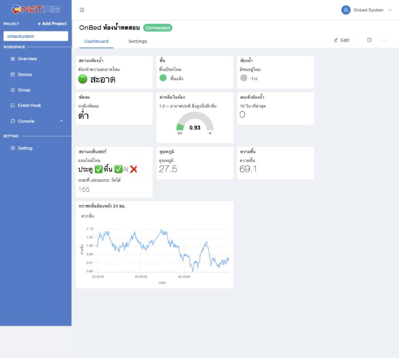

# Dashboard และการแจ้งเตือน — OnBedSystem

ผู้รับผิดชอบ: วัตตะนะ

## ภาพรวม

- **Dashboard:** `OnBed ห้องน้ำทดสอบ` บน NETPIE2020 (portal.netpie.io → project `onbedsystem`)
- **ลิงก์ dashboard:** _TODO: ใส่ลิงก์ถ้าแชร์แบบ public ได้_
- **ข้อมูลมาจาก:** gateway ส่งข้อมูลเข้า shadow ของ device `gateway` ทุก 10 วินาที (topic `@shadow/data/update`) dashboard อ่านค่าล่าสุดจาก shadow ส่วนกราฟย้อนหลังอ่านจาก feed
- **ข้อมูลย้อนหลัง (feed):** ตั้งใน Data Schema ของ device `gateway` ให้เก็บ 10 field ไว้ 1 วัน (`ttl: 1d`) ได้แก่ `odor`, `wc1_people`, `temp`, `hum`, `occupied`, `leak`, `fan_level`, `wc1_online`, `wc2_online`, `ai_online` เพราะแพ็กเกจฟรีของ NETPIE เก็บ feed ได้ไม่เกิน 10 data tag ต่อ device (ใส่ 16 field แล้วขึ้น "Data tag per device limit is exceeded") field ที่เหลือ (`seq`, `recv`, `dist_cm`, `estop`) ยังดูค่าล่าสุดได้จาก shadow ไฟล์ schema: [`netpie-schema.json`](netpie-schema.json) ข้อมูลระยะยาวสำหรับ AI เก็บเป็น CSV ด้วย `ai/collect.py`



_รูปที่ X dashboard ของระบบ_

## Datasource

ตั้งที่แท็บ **Settings** ของ dashboard → Dashboard Datasource → Add source

| Device | Alias | สิทธิ์ |
| --- | --- | --- |
| `gateway` | `gw` | Read Shadow, Read Feed |

ใน widget อ้างค่าล่าสุดด้วย `datasources["dash"]["gw"]["shadow"]["<field>"]` ส่วนกราฟใช้ datasource `#["gw"]["feed"]`

## Widget

จัดเป็น 4 แถว แถวละ 3 ช่อง เอาสิ่งที่แม่บ้านต้องรู้ก่อนไว้แถวบนสุด

| แถว | ช่อง (panel) | ชนิด | field | หมายเหตุ |
| --- | --- | --- | --- | --- |
| 1 | สถานะห้องน้ำ | Text (big) | `clean_status` | แปลงเป็นข้อความด้วย JS |
| 1 | พื้น | Indicator Light | `leak` | แดง = พื้นเปียก, เขียว = พื้นแห้ง |
| 1 | ห้องน้ำ | Indicator Light | `occupied` | เหลือง = มีคนอยู่, เทา = ว่าง |
| 2 | พัดลม | Text (big) | `fan_level`, `estop` | แปลงเป็น ปิด/ต่ำ/กลาง/สูง |
| 2 | ค่ากลิ่นในห้อง | Gauge (0.5 ถึง 4) | `odor` | สีเขียว/เหลือง/แดง ตามช่วง 0.5–1.5 / 1.5–2.5 / 2.5–4 |
| 2 | คนเข้าห้องน้ำ | Text (big) | `wc1_people` | จำนวนคนใน 10 วินาทีล่าสุด |
| 3 | สถานะเซ็นเซอร์ | Text | `wc1_online`, `wc2_online`, `ai_online`, `dist_cm` | ✅ / ❌ และระยะจาก ultrasonic |
| 3 | อุณหภูมิ | Text (big) | `temp` | °C |
| 3 | ความชื้น | Text (big) | `hum` | % |
| 4 | กราฟกลิ่นย้อนหลัง 24 ชม. | Chart | `odor` จาก feed | ย้อนหลัง 1 วัน |

## โค้ด JS ของ widget

NETPIE เติม `return` ไว้หน้าโค้ดในช่อง value ให้เอง โค้ดที่มีหลายบรรทัดจึงต้องห่อด้วย `(function(){ ... })()` ให้เป็น expression เดียว

สถานะห้องน้ำ:
```javascript
(function(){
  var s = datasources["dash"]["gw"]["shadow"]["clean_status"];
  if (s == "now")  return "🔴 ต้องทำความสะอาดทันที";
  if (s == "soon") return "🟡 ใกล้ถึงเวลาทำความสะอาด";
  return "🟢 สะอาด";
})()
```

พัดลม:
```javascript
(function(){
  var names = ["ปิด", "ต่ำ", "กลาง", "สูง"];
  var lv = datasources["dash"]["gw"]["shadow"]["fan_level"];
  var stop = datasources["dash"]["gw"]["shadow"]["estop"] == 1 ? " (หยุดฉุกเฉิน)" : "";
  return names[lv] + stop;
})()
```

สถานะเซ็นเซอร์:
```javascript
(function(){
  var sh = datasources["dash"]["gw"]["shadow"];
  function st(v) { return v == 1 ? "✅" : "❌"; }
  return "ประตู " + st(sh["wc1_online"]) + "   พื้น " + st(sh["wc2_online"]) + "   AI " + st(sh["ai_online"]);
})()
```

จำนวนคน: `String(datasources["dash"]["gw"]["shadow"]["wc1_people"])` (ใส่ `String()` เพราะถ้าเป็นเลข 0 ช่องจะว่าง)

## การแจ้งเตือน Discord

ส่งผ่าน Discord webhook (HTTPS POST `{"content": "..."}`) เข้า channel `แจ้งเตือนห้องน้ำ` webhook URL เป็นความลับ เก็บใน `secrets.h` (gateway) และ `config_secrets.py` (Python) ซึ่งไม่ขึ้น GitHub

| เหตุการณ์ | ใครส่ง | ข้อความ (แก้ได้ที่) |
| --- | --- | --- |
| พื้นเปียก / พื้นแห้ง | gateway | `MSG_LEAK`, `MSG_LEAK_DRY` ใน `firmware/gateway/include/discord.h` |
| กด / ยกเลิกหยุดฉุกเฉิน | gateway | `MSG_ESTOP_ON`, `MSG_ESTOP_OFF` ใน `discord.h` |
| ควรทำความสะอาด (ตอนนี้ / ภายใน 30 นาที) | AI service | `msg_clean_now`, `msg_clean_soon` ใน `ai/notifier.py` |
| ระบบขาดการเชื่อมต่อ / กลับมาออนไลน์ | AI service | `msg_gateway_offline`, `msg_gateway_back` ใน `notifier.py` |
| node ไม่ส่งข้อมูล / เซ็นเซอร์กลิ่นอ่านไม่ได้ | AI service | `msg_node_offline`, `msg_sensor_fault` ใน `notifier.py` |

**กันแจ้งเตือนรัว:** `Notifier` จำเวลาที่ส่งแต่ละเรื่องไว้ เรื่องเดิมไม่ส่งซ้ำภายใน 15 นาที ส่วน gateway ส่งเฉพาะตอนสถานะเปลี่ยน (เพิ่งเปียก / เพิ่งแห้ง) และไม่แจ้งให้ทำความสะอาดตอนมีคนอยู่ในห้อง (`occupied` = 1)

## ทดสอบโดยไม่ต้องมีบอร์ด

```bash
cd tools
cp gateway_secrets.example.py gateway_secrets.py   # ใส่ Client ID / Token / Secret ของ device gateway
python fake_gateway.py --live --interval 2
```
ห้ามเปิดพร้อม gateway จริง (ใช้ Client ID เดียวกัน)
