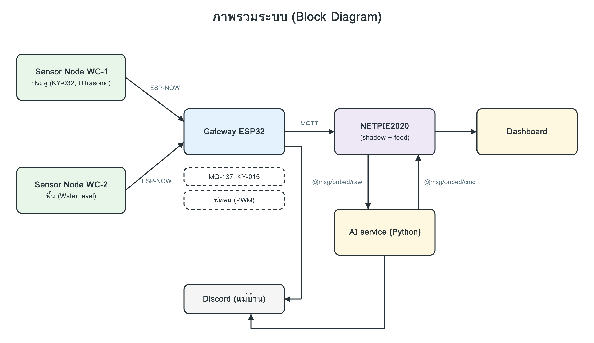

# สถาปัตยกรรมระบบ

## 1. การไหลของข้อมูล
1. Sensor node 2 ตัว: WC-1 ติดที่ประตู นับคนเดินผ่านด้วย KY-032 (เซ็นเซอร์อินฟราเรดแบบสะท้อน) และตรวจว่ามีคนอยู่ในห้องด้วย ultrasonic ส่วน WC-2 ติดใกล้พื้นจุดที่น้ำขัง ตรวจพื้นเปียกด้วย water level module ทั้งคู่ส่งให้ gateway ผ่าน ESP-NOW ทุก 10 วินาที และ WC-2 ส่งทันทีเมื่อสถานะพื้นเปลี่ยน
2. Gateway อ่านค่ากลิ่นจาก MQ-137 และอุณหภูมิ/ความชื้นจาก KY-015 ของตัวเอง รวมกับข้อมูลจาก node ตัดสินระดับพัดลมทุก 0.5 วินาที และส่งข้อมูลขึ้น NETPIE ทุก 10 วินาที
3. NETPIE เก็บข้อมูลดิบใน feed และแสดงผลบน dashboard
4. AI service รับข้อมูลจาก NETPIE ทำนายค่ากลิ่นในอีก 30 นาที แล้วส่งระดับพัดลมกลับไปที่ gateway
5. ระบบแจ้งแม่บ้านผ่าน Discord เมื่อควรทำความสะอาด พื้นเปียก หรืออุปกรณ์ขาดการเชื่อมต่อ

## 2. เหตุผลที่เลือกเทคโนโลยี
- ESP-NOW: node ไม่ต้องต่อ router ส่งตรงหา gateway ได้ เร็ว และใช้ Wi-Fi ที่มีในชิปอยู่แล้ว
- NETPIE2020: platform ของไทย มี shadow, feed และ dashboard ในตัว
- คุมพัดลมที่ gateway ไม่ใช่ที่ cloud: พัดลมยังทำงานได้แม้เน็ตหลุด
- AI รันบนคอม: ใช้โมเดลขนาดใหญ่ (Chronos-2) ได้และปรับง่าย ถ้า AI หลุด gateway มีวิธีสำรอง (fallback) คุมพัดลมจากค่ากลิ่นปัจจุบัน

## 3. การประมวลผลแบบ real-time ที่ gateway
gateway ตัดสินระดับพัดลมทุก 0.5 วินาทีจากข้อมูลล่าสุด และตรวจพื้นเปียกทันทีโดยไม่ต้องรอ cloud

## 4. การรองรับหลาย node (scalability)
ทุกข้อความมี node_id gateway ลงทะเบียน node ใหม่อัตโนมัติ (สูงสุด 4 ตัว) และสร้างชื่อ field บน cloud จาก node_id (WC-1 → wc1)

## 5. สิ่งที่เปลี่ยนจาก proposal
- ค่ากลิ่นใช้ R0/Rs แทน Rs/R0 เพราะความต้านทานของ MQ-137 ลดลงเมื่อมีแอมโมเนีย การกลับเศษส่วนทำให้ค่าเพิ่มขึ้นเมื่อเหม็น
- MQTT over TLS ของ NETPIE ใช้ port 1884 (proposal เขียน 8883)
- แจ้งเตือนผ่าน Discord (webhook) แทน Telegram
- AI ใช้ Chronos-2 (โมเดลพยากรณ์ time series สำเร็จรูป แบบ zero-shot) แทนการเทรน regression เองด้วย scikit-learn
- ใช้ MQ-137 ตัวเดียวและย้ายไปไว้ที่ gateway แทนที่จะอยู่บน node เพราะค่ากลิ่นคือค่าที่ใช้ตัดสินใจเร่งพัดลม การอ่านที่บอร์ดเดียวกับที่คุมพัดลมทำให้ตอบสนองได้ทุก 0.5 วินาทีโดยไม่ต้องรอข้อความ ESP-NOW
- จัดเซ็นเซอร์ใหม่เป็น node WC-1 (ประตู) = KY-032 + ultrasonic, node WC-2 (พื้น) = water level, gateway = MQ-137 + KY-015 เซ็นเซอร์ยังครบ 5 ชนิด มีอย่างน้อย 2 ชนิดทั้งฝั่ง node และ gateway และยังมี node จริง 2 ตัว
- นับคนที่ประตูจุดเดียว ไม่นับซ้ำที่โซนโถ
- เปลี่ยนเซ็นเซอร์เป็นตัวที่ยืมได้จากวิชา ทำหน้าที่เดิม: IR break-beam → KY-032, DHT22 → KY-015, PIR → ultrasonic HC-SR04 (ฟิลด์ `pir` เปลี่ยนเป็น `occupied` + `dist_cm`), water-leak → water level module