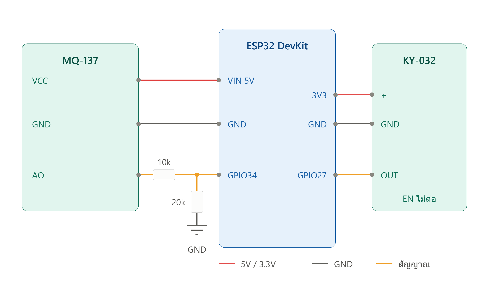
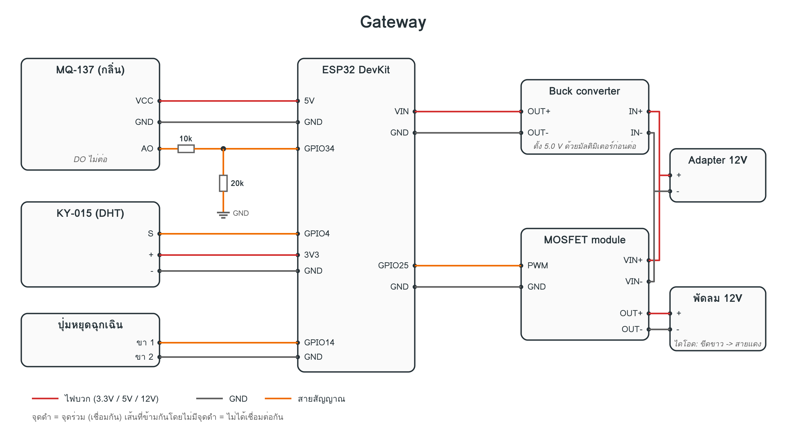

# Wiring

| บอร์ด | อุปกรณ์ | ขาอุปกรณ์ | ต่อกับ | หมายเหตุ |
| --- | --- | --- | --- | --- |
| Node WC-1 (ประตู) | KY-032 | + / GND / OUT | 3.3V / GND / GPIO27 | ขา EN ไม่ต่อ (เสียบ jumper EN ไว้) |
| Node WC-1 (ประตู) | Ultrasonic | VCC / GND / Trig | VIN (5V) / GND / GPIO26 | |
| Node WC-1 (ประตู) | Ultrasonic | Echo | ตัวต้านทาน 10k → GPIO33, และ GPIO33 → ตัวต้านทาน 20k → GND | Echo ออก 5 V ต้องลดเหลือ 3.3 V |
| Node WC-2 (พื้น) | Water level module | + / − / S | 3.3V / GND / GPIO35 | แผ่นเซ็นเซอร์วางบนพื้น ต่อสายยาวขึ้นมาที่กล่อง node ที่ยกสูง |
| Gateway | MQ-137 | VCC | ESP32 VIN (5V) | |
| Gateway | MQ-137 | GND | ESP32 GND | |
| Gateway | MQ-137 | AO | ตัวต้านทาน 10k → GPIO34, และ GPIO34 → ตัวต้านทาน 20k → GND | voltage divider ลด 5 V เหลือ 3.3 V |
| Gateway | KY-015 | S / ขากลาง (+) / − | GPIO4 / 3.3V / GND | |
| Gateway | ปุ่มหยุดฉุกเฉิน | ขา 1 / ขา 2 | GPIO14 / GND | |
| Gateway | MOSFET module | PWM(TRIG) / GND | GPIO25 / GND ของ ESP32 | GND ต้องต่อร่วมกับ adapter |
| Gateway | MOSFET module | VIN+ / VIN− | Adapter 12V + / − | |
| Gateway | MOSFET module | OUT+ / OUT− | พัดลมสายแดง / สายดำ | ไดโอดคร่อมพัดลม ขีดขาวไปทางสายแดง |
| Gateway | Buck converter (MP1584EN) | IN+ / IN− | Adapter 12V + / − | |
| Gateway | Buck converter (MP1584EN) | OUT+ / OUT− | ESP32 VIN / GND | **ตั้ง 5.0 V ด้วยมัลติมิเตอร์ก่อนต่อ** |

## ผังต่อสาย

> **รูปสองรูปด้านล่างยังเป็นผังชุดเดิม** (ตอนที่ MQ-137 อยู่บน node และ ultrasonic/water level อยู่บน gateway) ไอริณกำลังวาดใหม่ให้ตรงกับตารางด้านบน **ระหว่างนี้ให้ยึดตารางเป็นหลักเวลาต่อสาย**

**รูปที่ 1** ผังต่อสาย sensor node

**รูปที่ 2** ผังต่อสาย gateway

## จุดที่ต้องระวัง

- ขา AO ของ MQ-137 และขา Echo ของ ultrasonic ห้ามต่อเข้า ESP32 ตรง ต้องผ่าน voltage divider (5 V จะทำให้ขาเสีย)
- GND ของ ESP32 ต้องต่อกับ GND ของ adapter 12 V ไม่งั้น MOSFET สั่งงานไม่ได้
- ตั้ง buck converter ให้ออก 5.0 V ก่อนต่อเข้า ESP32 และถอดสาย 5 V ออกตอนเสียบ USB อัปโหลดโค้ด
